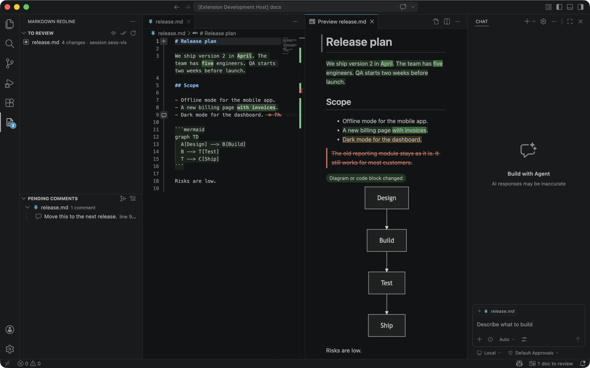
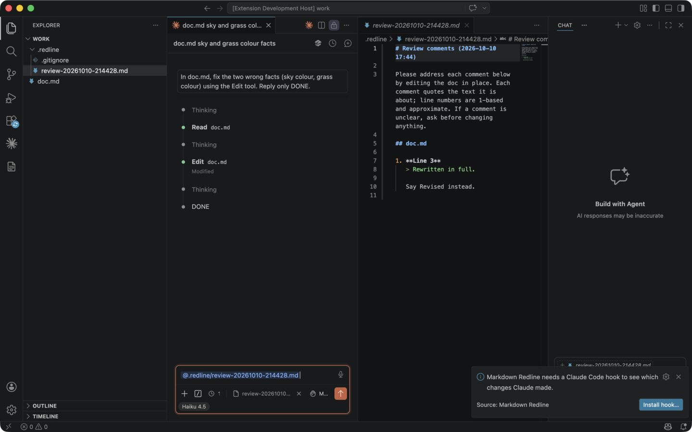

# Penmark

Review the markdown docs Claude Code writes for you, without re-reading them. See only what Claude changed, comment on the text, and send all your comments back to Claude in one go.

## Why

When Claude Code edits a long design doc or a set of docs in one go, finding what changed means reading everything again. Git diffs show raw markdown line by line and mix in your own edits. Penmark highlights, sentence by sentence, exactly what Claude changed since you last reviewed the doc, in the rendered preview (diagrams included) and in the editor.

## How it works

1. **Claude edits your docs.** A small Claude Code hook records the text before and after each edit Claude makes to a markdown file, whether through its edit tools or a shell command (`sed`, an inline script). It doesn't slow Claude down noticeably, and edits you make yourself are never recorded.
2. **You review only the changes.** Open a doc from the **To review** panel. New and reworded sentences are highlighted (changed words more strongly), and removed text appears struck through where it was. Press **⌥]** and **⌥[** to jump between changes.
3. **You comment and send.** Select text and press **⌥C**: a comment box opens right under it. Type and save. When you're done, click **Send**: all comments go to Claude together, in the session that wrote the doc. Nothing is sent until you press Enter in Claude's chat.

## Features

- **Sentence-level highlights** in VS Code's built-in markdown preview and in the source editor. Changes pile up across Claude's turns and sessions until you mark the doc reviewed.
- **Your own edits are left out.** Only changes Claude made are highlighted, even if you edited the doc in between.
- **Removals shown in place**: a struck-through sentence, or a "lines removed" block you can expand.
- **Works with Mermaid previews.** Diagrams render as usual (with an extension such as *Markdown Preview Mermaid Support*). A changed diagram gets a "changed" badge.
- **To review** panel: every doc Claude changed, with the number of changes and the session that made them.
- **Comments without clicking**: ⌥C on a selection opens a comment box right under the text, in the preview or the editor. Comments are kept until you send them, across files and restarts.
- **One-click send to Claude Code**: writes one notes file and puts it in the right Claude chat: the session that wrote the doc, or else the Claude tab you have open (empty or mid-conversation), or else a new one. If the comments cover docs from several sessions, you pick one.
- **Show/hide highlights** from the eye button in the panel or editor toolbar (an open eye while they're showing, a crossed-out eye while hidden), the status bar, or **⌃⌥H**.

## Getting started

1. Install the extension.
2. Run **Penmark: Install Claude Code hook** from the Command Palette, or click **Install hook…** when prompted. You'll see the exact change to `~/.claude/settings.json` before it's written. Your other hooks stay as they are, and a backup is kept.
3. Restart any Claude Code sessions that were already running.
4. Ask Claude to edit some markdown. The docs it changes appear in the **Penmark** panel in the activity bar.

## Keyboard shortcuts

⌥ is the Option key on a Mac; on Windows and Linux use Alt, and Ctrl for ⌃.

| Mac | Windows / Linux | Where | Does |
|---|---|---|---|
| **⌥C** | Alt+C | Markdown editor or preview, with text selected | Open a comment box under the selection. In the preview, Enter saves (Shift+Enter for a new line); in the editor, ⌘Enter / Ctrl+Enter saves |
| **⌥]** / **⌥[** | Alt+] / Alt+[ | Markdown editor or preview | Next / previous change |
| **⌃⌥H** | Ctrl+Alt+H | Markdown editor or preview | Show / hide highlights |
| **⌃⌥↩** | Ctrl+Alt+Enter | Anywhere, when comments are pending | Send comments to Claude |

You can change the editor shortcuts in **Keyboard Shortcuts** (search "Penmark"). The keys inside the preview are fixed.

The first time you comment from the preview, VS Code asks whether Penmark may open a link. Allow it once and it won't ask again.

## Settings

| Setting | Default | |
|---|---|---|
| `penmark.storageDir` | `~/.claude/penmark` | Where copies of Claude's edits and your pending comments are kept. Changing it offers to move what's there. |
| `penmark.showRemovals` | `true` | Show text Claude removed, struck through. |
| `penmark.markReviewedOnSend` | `true` | When you send comments on a doc, mark it reviewed so Claude's next changes stand out on their own. |

## Requirements

- VS Code 1.90 or newer.
- Claude Code: the VS Code extension for one-click send, or the CLI (comments are then put on your clipboard).
- Node.js 18 or newer on your machine, which runs the hook.
- Tested on macOS. Windows and Linux should work but haven't been tested yet.

## Privacy

Everything stays on your machine. The hook copies the markdown files Claude edits into the storage folder, and nothing is sent anywhere. Comments go to Claude only when you press Enter in Claude's chat.

## Known limitations

- Shell-command edits are caught when the command names the markdown file (for example `sed -i … plan.md` or a script that opens `"plan.md"`). A command that builds the file name at run time, such as `for f in *.md`, isn't caught.
- Sending to an already-open Claude tab attaches the notes file as an @-mention. If more than one Claude tab is visible side by side, the prompt is copied to your clipboard instead, because Claude Code would put the mention in all of them.
- Penmark uses Claude Code commands that aren't a documented API, so a Claude Code update may change how sending works. Highlights and comments don't depend on them.
- Changes inside a Mermaid diagram are flagged per diagram, not per node.

## Uninstalling

Run **Penmark: Uninstall Claude Code hook** first. It removes only its own entry from `~/.claude/settings.json`. Then uninstall the extension. You can delete the storage folder afterwards.

## More

- [How it works](docs/how-it-works.md): the hook, what's stored, and how changes are worked out.
- [Development](docs/development.md): building, testing and publishing.
- [Changelog](CHANGELOG.md)

## License

Free for everyone, with no conditions: [0BSD](LICENSE). Use it, copy it, change it, ship it, sell it; no attribution needed. The bundled diff library has its own BSD license notice in [THIRD_PARTY_NOTICES.md](THIRD_PARTY_NOTICES.md).

Penmark is an independent project and is not affiliated with or endorsed by Anthropic.
