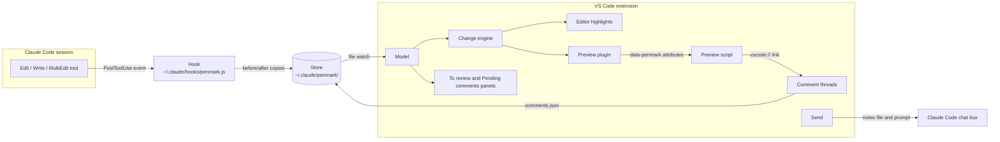

# How Penmark works

For anyone changing or debugging the extension. User-facing behaviour is in the [README](../README.md); the reasoning behind each decision is in [plan.md](plan.md), and the Claude Code findings it relies on are in [spike.md](spike.md).

## Moving parts



| Part | File | Runs in |
|---|---|---|
| Hook | `hooks/penmark.js` | Its own Node process, started by Claude Code after each edit |
| Store reader | `src/store.ts`, `src/comments.ts`, `src/sessions.ts` | Extension host |
| Change engine | `src/changes.ts` | Extension host |
| Model | `src/model.ts` | Extension host |
| Editor highlights, status bar, navigation | `src/editorHighlights.ts` | Extension host |
| Preview plugin | `src/previewPlugin.ts` | Extension host, inside the built-in markdown engine |
| Preview script and styles | `media/preview.js`, `media/preview.css` | The preview webview |
| Panels | `src/views.ts` | Extension host |
| Comment threads | `src/commentThreads.ts` | Extension host |
| Send | `src/send.ts`, `src/notes.ts` | Extension host |
| Hook installer | `src/hookInstaller.ts`, `src/extension.ts` | Extension host |

Everything without a `vscode` import (`store`, `comments`, `sessions`, `changes`, `notes`, `hookInstaller`, `paths`) is unit-tested with plain Node.

## The hook

Claude Code runs the hook after every `Edit`, `Write`, `MultiEdit` or `Bash` call, and before every `Bash` call. The event arrives as JSON on stdin.

**Edit tools.** After the edit, the hook:

1. ignores anything that isn't a `.md` or `.markdown` file, or that lives inside the store;
2. takes the text before the edit from `tool_response.originalFile` (`null` means Claude created the file);
3. reads the text after the edit from disk;
4. writes both copies, then appends one line to `edits.jsonl`.

**Shell commands.** Claude often edits with `sed`, a heredoc or an inline script instead. Before a `Bash` call, the hook finds the markdown file names in the command (quoted, or bare with `\`-escaped spaces). It resolves them against the session's folder and every `cd` target in the command, and saves the current text of up to 30 of them to `<store>/pending/<tool_use_id>.json`. After the call, it compares each one and records those that changed, with `tool: "Bash"`. Commands that don't mention `.md` or `.markdown` cost one quick check and nothing else. A name built at run time (`for f in *.md`) isn't seen. Snapshots left behind by a command that never finished are dropped after a day.

It prints nothing and always exits 0, so it can't disturb the Claude session. Errors go to `<store>/hook-errors.log`. A rejected edit never fires PostToolUse, so nothing is left over.

The hook can't read VS Code settings, so the extension writes the storage folder to a pointer file, `~/.claude/penmark.json`. `PENMARK_CLAUDE_DIR` overrides `~/.claude` for both the hook and the extension; the tests use it.

**Install hook** copies the script to `~/.claude/hooks/penmark.js` (a fixed path that survives extension updates). It adds a `PreToolUse` entry (matcher `Bash`) and a `PostToolUse` entry (matcher `Edit|Write|MultiEdit|Bash`) to `~/.claude/settings.json`, using an absolute `node` path; it prefers a Node that doesn't live under nvm, so switching nvm versions doesn't break it. It shows a diff, waits for confirmation, keeps a backup, and never touches other hooks. **Uninstall** removes exactly those entries. On startup the extension refreshes the installed script if a newer one ships with it, and offers to update the settings entries if they're from an older version.

## The store

```
~/.claude/penmark/              (the storageDir setting)
  files/<key>/edits.jsonl                one line per Claude edit to one doc
  files/<key>/<id>.before.md             text before that edit
  files/<key>/<id>.after.md              text after that edit
  comments.json                          pending review comments
  doc-sessions.json                      last Claude session to edit each doc
  sent/<time>.json                       comments already sent, with the notes path
  hook-errors.log                        only if the hook hit a problem
```

- `<key>` is the first 16 hex characters of the SHA-1 of the doc's canonical path (`realpath`, so symlinks and letter case resolve the same way in the hook and the extension).
- An `edits.jsonl` line holds `id`, `at`, `path`, `tool`, `newFile`, `sessionId`, `promptId`, `toolUseId`, `transcriptPath` and `cwd`.
- **Mark reviewed** renames `files/<key>` away and deletes it, so the doc's baseline becomes its current text. A hook writing at that moment starts a fresh folder.
- `doc-sessions.json` survives Mark reviewed, so comments sent later still go to the session that wrote the doc.

## Working out what Claude changed

`computeChanges(baseline, current, pairs)` in `src/changes.ts`:

- `baseline` is the text before Claude's first unreviewed edit;
- `pairs` holds the before/after text of every unreviewed edit;
- `current` is the doc now, including any unsaved editor changes.

Steps:

1. **Split into sentences.** Each line is split at `.`, `!` or `?` followed by whitespace. List, heading and quote markers are left out. A fenced block (code or Mermaid) is one token. Tokens keep their offsets in the source.
2. **Collect what Claude did.** For every edit pair, diff the sentences. The sentences Claude added and the ones it removed go into two multisets.
3. **Diff baseline against current**, sentence by sentence. Keep an addition only if it's in Claude's "added" set, and a removal only if it's in Claude's "removed" set. Everything else is the user's own edit and is dropped.
4. **Pair rewrites.** Where removals are followed by additions, a removed and an added sentence that share at least 40% of their words become one *modified* change. `diffWords` then marks the changed words. Unpaired removals are shown just before the text that replaced them.
5. **Place removals.** A removal is a point after the sentence before it. If whole lines went, it's flagged `block` and the preview shows it as its own struck-through block.

The model caches results by doc, edit count and text hash, so typing in the editor or re-rendering the preview stays cheap.

## Highlights in the editor

`EditorHighlights` decorates visible markdown editors:

- additions and modifications get the theme's "inserted line" background;
- changed words get the stronger "inserted text" background;
- removals become an inline struck-through label, and hovering shows the full text.

It refreshes when the store changes and 250 ms after typing stops. The status bar shows the number of changes, and clicking it toggles highlights.

## Highlights in the preview

VS Code's built-in preview runs markdown-it plugins from every extension, so ours works alongside Mermaid extensions. The plugin (`src/previewPlugin.ts`) gets only the markdown text, not the file name (`env.currentDocument` is empty there), so `Model.pathForText` finds the doc by comparing the text with tracked docs and open editors. It then:

- puts a `data-penmark` attribute on the innermost visible block of each change. It holds JSON with the added sentences, the modified sentences and their changed words, inline removals with the sentence before them, and commented quotes, each as rendered text (`md.renderInline` with the tags stripped). Tight-list paragraphs are hidden by markdown-it, so their list item carries the data instead;
- inserts HTML blocks for whole-block removals (a `<details>` element when more than 3 lines went) and for changed diagrams or code blocks;
- always adds a hidden `#penmark-meta` element with the extension ID, so the script can build comment links.

`media/preview.js` runs on load and after every `vscode.markdown.updateContent` event. For each tagged block it finds the text in the page, ignoring whitespace differences, and registers ranges with the **CSS Custom Highlight API**. The page's markup is left unchanged, apart from the inserted `<del>` elements for removals. **⌥] / ⌥[** (Alt on Windows and Linux) scroll between changes.

**⌥C** (Alt+C on Windows and Linux) in the preview draws a comment box under the selection, inside the preview page. Enter opens a `vscode://<extension id>/comment?source=…&line=…&endLine=…&text=…&body=…` link. The extension's URI handler maps the rendered text back to a source range (`findInLines` allows markup between words) and saves the comment. VS Code asks the user once to allow the link.

## Comments

`comments.json` holds `{id, path, line, startChar, endLine, endChar, quote, body, createdAt}` entries. `CommentThreads` shows each one as a read-only VS Code comment thread. In the editor, ⌥C runs `workbench.action.addComment`, which opens VS Code's own comment box under the selection; the **+** in the margin opens the same box. Either way, submitting it saves through `penmark.saveNativeComment`.

## Sending to Claude Code

`sendComments` (`src/send.ts`):

1. **Picks the session.** It looks up the sessions in `doc-sessions.json` for the docs in the batch. With one session it uses that; with several it asks. With none, it uses the Claude tab that's already open (empty or mid-conversation), or a new session if there isn't one.
2. **Writes the notes file** to `<session cwd>/.penmark/review-<time>.md`. It also writes `.penmark/.gitignore` containing `*`, so git ignores the folder without changing the repo's own `.gitignore`. Each comment's line is re-located from its quoted text, since the doc may have changed.
3. **Copies the prompt to the clipboard**, as a fallback that always works.
4. **Delivers it** using Claude Code's commands. They're undocumented; findings and evidence are in [spike.md](spike.md):
   - new session, or a session not open in a tab: `claude-vscode.editor.open(sessionId, prompt)` fills in the chat box;
   - a session open in a tab: Claude Code refuses a prompt there. So Send brings that tab to the front, matching it by the transcript's `aiTitle` against the shortened tab label. If it's the only visible Claude tab, Send briefly shows the notes file in another column, runs `claude-vscode.insertAtMention`, closes the notes file again, and puts the cursor in the chat box (`claude-vscode.focus`). Otherwise the clipboard fallback applies;
   - no known session but a Claude tab is open: the same @-mention route into the visible Claude tab. If none is visible, Claude Code brings its most recent tab to the front. If several are visible, the clipboard fallback applies;
   - Claude Code tabs are never closed.
5. **Archives the comments** to `sent/` and, if `markReviewedOnSend` is on, marks the commented docs reviewed.

## Tests

- `npm test`: unit tests for the hook (run as a child process with fake events), store, installer, change engine, comments and notes.
- `npm run test:integration`: runs `test/integration/index.js` in an isolated VS Code window with a temporary `~/.claude` stand-in. It covers install, highlights, preview rendering, the toggle, comments, storage moves, Send and uninstall.

See [development.md](development.md).
